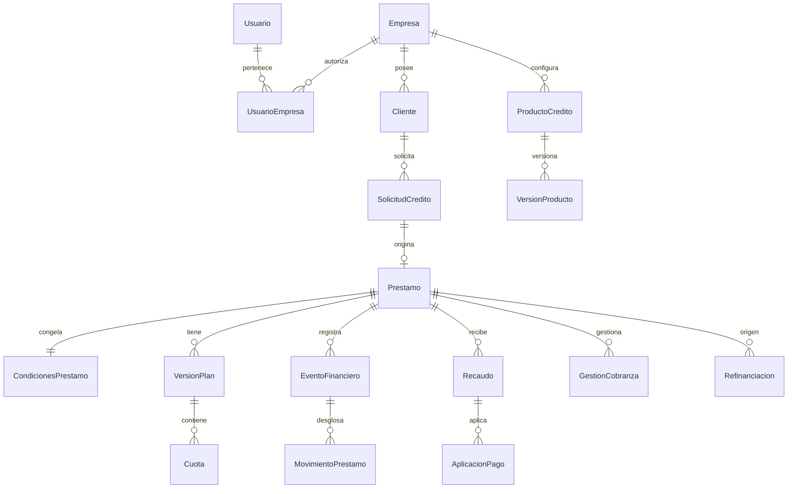

# Modelo de datos para préstamos, recaudos y cartera

Este documento define el modelo lógico de la fase 2. Su objetivo es que las operaciones financieras puedan reconstruirse, auditarse y aislarse por empresa antes de fijar el esquema físico de SQL Server y las fórmulas del motor financiero. Las decisiones de tasas, base de mora y convenciones de días se detallarán en la fase 3.

## Principios del modelo

1. **Empresa obligatoria.** Toda entidad de negocio pertenece a una empresa mediante `IdEmpresa`. `Usuario` y los catálogos técnicos globales son excepciones explícitas; el acceso del usuario se concede por `UsuarioEmpresa`.
2. **Movimientos inmutables.** El libro del préstamo registra deltas por componente. Los saldos almacenados son proyecciones reconciliables, nunca el único origen de la verdad. Correcciones, anulaciones y ajustes agregan movimientos compensatorios.
3. **Documento original preservado.** Un recaudo, una aprobación y una condonación conservan sus datos originales, actor, fecha y causa. Su efecto puede revertirse sin borrar el hecho ocurrido.
4. **Condiciones históricas.** El préstamo conserva las condiciones aprobadas, aunque el producto cambie. Cada plan de pagos tiene versión y solo una versión está vigente.
5. **Plan y causación separados.** La cuota proyecta obligaciones contractuales; el libro registra montos efectivamente causados y pagados. Los reportes no suman ambos como si fueran deudas independientes.
6. **Identificadores estables.** Las entidades públicas usan `uniqueidentifier`; el número de préstamo es legible y único dentro de la empresa. Las operaciones externas usan una clave de idempotencia.

## Vista de relaciones

El diagrama resume el núcleo; las relaciones detalladas y las restricciones aparecen a continuación.

## Convenciones físicas

| Campo o regla | Propuesta |
|---|---|
| Identificadores | `uniqueidentifier`, generados en la aplicación o en SQL Server según la estrategia elegida en implementación. |
| Dinero | `decimal(19,4)` para importes internos; la escala de presentación y el redondeo contractual son una política distinta. |
| Tasas | `decimal(18,10)` expresadas como fracción: `0.12` significa 12 %. El tipo y periodo de la tasa se guardan por separado. |
| Fechas | `date` para fechas financieras; `datetimeoffset` o UTC normalizado para instantes de auditoría. La empresa define zona horaria para su cierre. |
| Concurrencia | `rowversion` en agregados mutables como `Prestamo`, `Recaudo` y `SesionCaja`. |
| Borrado | Sin borrado físico de transacciones financieras. Catálogos y datos maestros se desactivan según política de retención. |
| Moneda | `CodigoMoneda char(3)` en producto, préstamo, recaudo y movimientos; una operación financiera mezcla una sola moneda. Conversión de moneda queda fuera del alcance inicial. |

La precisión propuesta es una decisión de almacenamiento, no una fórmula. La fase 3 fijará la precisión de cálculo intermedia y el redondeo por operación para evitar residuos acumulados.

## Empresas, usuarios y permisos

| Entidad | Campos y relaciones principales | Restricciones |
|---|---|---|
| `Empresa` | `IdEmpresa`, nombre, identificación fiscal, estado, zona horaria, moneda base, fecha de creación. | Identificación fiscal única según ámbito definido. |
| `Usuario` | `IdUsuario`, identificador de acceso, credenciales o proveedor de identidad, estado, fechas de acceso. | Identificador de acceso único global. |
| `UsuarioEmpresa` | `IdEmpresa`, `IdUsuario`, estado, fechas de vigencia. | PK compuesta `(IdEmpresa, IdUsuario)`; membresía activa para operar. |
| `Rol` | `IdRol`, `IdEmpresa`, código, nombre, estado. | Código único por empresa. Los roles iniciales se crean como datos semilla. |
| `Permiso` | `IdPermiso`, código, descripción. | Código técnico único. |
| `RolPermiso` | `IdEmpresa`, `IdRol`, `IdPermiso`. | Rol de la misma empresa; combinación única. |
| `UsuarioRol` | `IdEmpresa`, `IdUsuario`, `IdRol`. | Usuario miembro y rol de la misma empresa; combinación única. |

La selección de empresa activa se valida en cada solicitud y proceso. El rol controla un conjunto configurable de permisos; las operaciones sensibles verifican además el préstamo o recaudo concreto y el alcance empresarial.

## Clientes y documentos

| Entidad | Campos y relaciones principales | Restricciones |
|---|---|---|
| `Cliente` | `IdCliente`, `IdEmpresa`, tipo y número de identificación, nombre o razón social, contacto, dirección, ciudad, fecha de nacimiento, actividad, ingresos, empleador, estado, creación. | `(IdEmpresa, TipoIdentificacion, Identificacion)` único para registros vigentes. |
| `ReferenciaCliente` | `IdReferencia`, `IdEmpresa`, `IdCliente`, tipo personal o comercial, nombre, contacto, observaciones. | FK empresarial al cliente. |
| `DocumentoCliente` | `IdDocumento`, `IdEmpresa`, `IdCliente`, tipo, nombre, ubicación externa, hash, tamaño, fecha, usuario cargador, estado. | FK empresarial; archivo fuera de la base transaccional y acceso autorizado. |

Los totales e historial crediticio mostrados en la ficha del cliente se derivan de préstamos, cuotas y movimientos. No se mantienen como columnas independientes en `Cliente`.

## Productos, solicitudes y préstamos

| Entidad | Campos y relaciones principales | Restricciones |
|---|---|---|
| `ProductoCredito` | `IdProducto`, `IdEmpresa`, código, nombre, descripción, estado. | Código único por empresa. |
| `VersionProducto` | `IdVersionProducto`, `IdEmpresa`, `IdProducto`, número de versión, vigencia, moneda, montos y plazos permitidos, configuración financiera. | `(IdEmpresa, IdProducto, NumeroVersion)` único; la versión publicada es inmutable. |
| `ReglaCargoProducto` | `IdReglaCargo`, `IdEmpresa`, `IdVersionProducto`, tipo seguro/comisión/gasto, base, importe o tasa, periodicidad y prioridad. | Regla versionada con el producto. |
| `PoliticaAplicacionPago` | `IdPolitica`, `IdEmpresa`, código, versión, secuencia de componentes y ámbito vencido o corriente. | Versión publicada inmutable. |
| `SolicitudCredito` | `IdSolicitud`, `IdEmpresa`, `IdCliente`, `IdVersionProducto`, monto, plazo, propósito, fechas, estado, solicitante y decisión. | Transiciones de estado controladas; decisión con actor y motivo. |
| `Prestamo` | `IdPrestamo`, `IdEmpresa`, `IdCliente`, `IdProducto`, `IdSolicitud`, número, fechas de solicitud/aprobación/desembolso, capital original, moneda, estado, versión de concurrencia. | `(IdEmpresa, NumeroPrestamo)` único; cliente, producto y solicitud de la misma empresa. |
| `CondicionesPrestamo` | `IdEmpresa`, `IdPrestamo`, referencia a versión de producto y política de pago, tasa, tipo y periodo de tasa, modalidad simple/compuesta, capitalización expresa, sistema de amortización, periodicidad, plazo, gracia, mora, cargos, convención de días, versión de política. | Una condición contractual aprobada por préstamo; cambios posteriores se documentan mediante versión o acto autorizado. |

`CondicionesPrestamo` debe contener columnas tipadas para todo dato usado en cálculos o consultas. Puede conservar además una copia serializada de la configuración aprobada para auditoría, pero el cálculo no debe depender de un JSON opaco. En aprobación se copian las condiciones; en desembolso se confirma la fecha efectiva y se genera el plan contractual. La simulación anterior no crea movimientos reales.

El estado del préstamo pertenece a una máquina de estados: `BORRADOR`, `SOLICITADO`, `APROBADO`, `RECHAZADO`, `DESEMBOLSADO`, `ACTIVO`, `EN_MORA`, `REFINANCIADO`, `CANCELADO`, `CASTIGADO`. Cada transición válida crea un registro de historial y auditoría. `EN_MORA` puede modelarse como estado operativo derivado para evitar perder el estado contractual; la implementación definirá esa separación antes de migrar datos.

## Plan de amortización y cuotas

| Entidad | Campos y relaciones principales | Restricciones |
|---|---|---|
| `VersionPlan` | `IdVersionPlan`, `IdEmpresa`, `IdPrestamo`, número, motivo, fecha de creación, usuario, estado vigente/sustituida, referencia a plan anterior. | Una sola versión vigente por préstamo; `(IdEmpresa, IdPrestamo, NumeroVersion)` único. |
| `Cuota` | `IdCuota`, `IdEmpresa`, `IdVersionPlan`, número, fecha de vencimiento, saldo inicial previsto, capital, interés, seguros, otros cargos, valor previsto, estado proyectado. | `(IdEmpresa, IdVersionPlan, NumeroCuota)` único; sumas previstas conciliadas con el plan. |
| `CuotaPersonalizada` | `IdEmpresa`, `IdVersionPlan`, `IdCuota`, importe o porcentaje pactado y justificación. | Solo para planes configurados como personalizados. |

Los campos pagados y el saldo pendiente de cada cuota se obtienen de `AplicacionPago` y ajustes vinculados a la cuota; si se materializan por rendimiento, se tratan como proyecciones reconciliables. Sustituir un plan conserva las cuotas anteriores y sus aplicaciones históricas. Solo las cuotas del plan vigente se usan para cobros futuros, mientras los importes ya causados permanecen en el libro.

## Libro mayor y saldos

| Entidad | Campos y relaciones principales | Restricciones |
|---|---|---|
| `EventoFinanciero` | `IdEvento`, `IdEmpresa`, `IdPrestamo`, tipo, fecha efectiva, instante de registro, actor o proceso, referencia de origen, clave de idempotencia, evento reversado, motivo. | `(IdEmpresa, Tipo, ClaveIdempotencia)` único cuando exista clave; eventos inmutables. |
| `MovimientoPrestamo` | `IdMovimiento`, `IdEmpresa`, `IdPrestamo`, `IdEvento`, `IdCuota` opcional, componente, importe con signo, moneda, secuencia del préstamo. | `(IdEmpresa, IdPrestamo, Secuencia)` único; importe distinto de cero; inmutable. |
| `SaldoPrestamo` | `IdEmpresa`, `IdPrestamo`, capital, interés corriente, mora, cargos, saldo a favor, total, última secuencia aplicada, versión. | Proyección actualizada en la misma transacción que el libro; reconstruible. |
| `HistorialEstadoPrestamo` | `IdEmpresa`, `IdPrestamo`, estado anterior/nuevo, fecha, actor, motivo, `IdEvento` opcional. | Solo anexar registros. |

Los componentes iniciales del libro son `CAPITAL`, `INTERES_CORRIENTE`, `MORA`, `SEGURO`, `CARGO` y `SALDO_A_FAVOR`. Un desembolso aumenta capital; una causación aumenta el componente correspondiente; un pago lo disminuye. Una capitalización permitida mueve importe de interés corriente a capital mediante dos movimientos del mismo evento, sin alterar el total. Una condonación disminuye el componente autorizado. Un pago excedente crea saldo a favor o se rechaza según la política, sin producir un saldo de deuda negativo por accidente.

El evento y sus movimientos constituyen una sola operación atómica. `SaldoPrestamo` y cualquier dashboard son lecturas materializadas: ante diferencias, se reconstruyen desde la secuencia de movimientos y se registra la incidencia. El libro del préstamo es operativo; los asientos de contabilidad general del ERP se publicarán por integración y no se infieren como equivalentes automáticos.

## Recaudos, aplicaciones y caja

| Entidad | Campos y relaciones principales | Restricciones |
|---|---|---|
| `Recaudo` | `IdRecaudo`, `IdEmpresa`, `IdPrestamo`, `IdCliente`, fecha efectiva, importe recibido, moneda, medio, banco/caja, referencia externa, observación, usuario, registro, estado, clave de idempotencia. | Importe positivo; cliente y préstamo de la misma empresa; referencia única según medio y origen cuando proceda. |
| `AplicacionPago` | `IdAplicacion`, `IdEmpresa`, `IdRecaudo`, `IdPrestamo`, `IdCuota` opcional, componente, importe, orden, `IdEvento`. | Suma aplicada más excedente igual al recaudo; importes positivos; cuota del mismo préstamo. |
| `ReversoRecaudo` | `IdReverso`, `IdEmpresa`, `IdRecaudo`, motivo, autorizador, fecha, `IdEvento` compensatorio. | Un reverso efectivo por recaudo; el recaudo original permanece. |
| `SesionCaja` | `IdSesionCaja`, `IdEmpresa`, sucursal, usuario, apertura, saldo inicial, cierre, total esperado, total contado, diferencia, estado. | Una sesión abierta por usuario/caja según política. |
| `MovimientoCaja` | `IdMovimientoCaja`, `IdEmpresa`, `IdSesionCaja`, `IdRecaudo` opcional, tipo, importe, fecha, usuario. | Inmutable y conciliable con recaudos en efectivo. |

La aplicación de pagos usa la versión de política guardada en el préstamo o una modificación contractual autorizada. Cambiar una aplicación requiere reversarla y registrar una nueva aplicación; el dinero recibido originalmente nunca se elimina.

## Mora, causación y cierre

| Entidad | Campos y relaciones principales | Restricciones |
|---|---|---|
| `CalculoMora` | `IdCalculoMora`, `IdEmpresa`, `IdPrestamo`, `IdCuota`, fecha desde/hasta, días, base, tasa, importe, regla aplicada, actor/proceso, `IdEvento`. | Un periodo de causación no se duplica; simulaciones no persisten. |
| `Capitalizacion` | `IdCapitalizacion`, `IdEmpresa`, `IdPrestamo`, fecha, base, tasa/regla, importe, autorización contractual, `IdEvento`. | Solo cuando `CondicionesPrestamo` la permite expresamente. |
| `EjecucionCierreDiario` | `IdEjecucion`, `IdEmpresa`, fecha de negocio, tipo de proceso, estado, inicio/fin, versión de reglas, conteos y error. | `(IdEmpresa, FechaNegocio, TipoProceso)` único para ejecución efectiva; reintentos controlados. |
| `TrabajoCierrePrestamo` | `IdEmpresa`, `IdEjecucion`, `IdPrestamo`, estado, última operación, error. | Permite reanudar cierre por préstamo sin duplicar causaciones. |

Además de la unicidad de la ejecución, cada causación tendrá una clave determinística por préstamo, componente y periodo. Esa segunda barrera evita duplicados si un proceso se interrumpe después de confirmar algunos préstamos.

## Operaciones especiales y cobranza

| Entidad | Campos y relaciones principales | Restricciones |
|---|---|---|
| `AbonoExtraordinario` | `IdAbono`, `IdEmpresa`, `IdPrestamo`, `IdRecaudo`, opción reducir plazo/cuota/mantener/cancelar, simulación aceptada, plan anterior/nuevo, actor. | Aplicación a capital trazada en el recaudo y libro. |
| `Condonacion` | `IdCondonacion`, `IdEmpresa`, `IdPrestamo`, componente, valor original, valor condonado, saldo resultante, motivo, solicitante, autorizador, fecha, `IdEvento`. | Permiso especial; autorización separada cuando la política lo exija. |
| `Refinanciacion` | `IdRefinanciacion`, `IdEmpresa`, `IdPrestamoOriginal`, `IdPrestamoNuevo`, capital, interés, mora, cargos, condonaciones, motivo, autorizador, fecha, `IdEvento`. | Préstamos de la misma empresa; relación única para la operación. |
| `GestionCobranza` | `IdGestion`, `IdEmpresa`, `IdCliente`, `IdPrestamo`, gestor, canal, fecha/hora, resultado, observación, próxima gestión. | Cliente y préstamo de la misma empresa. |
| `PromesaPago` | `IdPromesa`, `IdEmpresa`, `IdGestion`, fecha e importe prometidos, estado, cumplimiento y fecha de evaluación. | Historial de cambios de estado. |

Una refinanciación crea un préstamo nuevo y relaciona ambos. La composición del saldo transferido queda explícita; transformar intereses o mora en nuevo capital requiere una regla contractual y autorización, nunca una conversión implícita.

## Auditoría, reportes e integraciones

| Entidad | Campos y relaciones principales | Restricciones |
|---|---|---|
| `EventoAuditoria` | `IdAuditoria`, `IdEmpresa`, módulo, operación, entidad/registro, actor, fecha/hora, IP, valores antes/después, motivo, correlación. | Solo anexar; acceso restringido. |
| `EventoIntegracion` | `IdEventoIntegracion`, `IdEmpresa`, tipo, agregado, identificador, versión, carga, fecha, estado y reintentos. | Outbox escrita en la misma transacción que el evento de negocio. |
| `EntregaIntegracion` | `IdEntrega`, `IdEmpresa`, `IdEventoIntegracion`, destino, intento, resultado, respuesta y fecha. | Historial de entregas y fallos. |
| `ProyeccionCartera` | `IdEmpresa`, `IdPrestamo`, fecha de corte, saldos, días de mora, edad, vencidos. | Proyección derivada y reconstruible. |

Las exportaciones y consultas de dashboard usan datos con `IdEmpresa` y fecha de corte. La bitácora de auditoría explica cambios administrativos; el libro explica cambios monetarios. Ambos registros se enlazan por identificador de correlación.

## Restricciones de integridad imprescindibles

1. En tablas empresariales, definir una clave alternativa `(IdEmpresa, IdEntidad)` y claves foráneas compuestas desde entidades hijas. Esto impide que un préstamo de una empresa apunte a un cliente de otra aunque sus GUID sean válidos.
2. Unicidad de número de préstamo por empresa, versión de producto, versión de plan, número de cuota, secuencia del libro y clave de idempotencia por ámbito.
3. Restricciones `CHECK` para importes recibidos positivos, tasas y plazos en rango, fechas coherentes y componentes de movimiento válidos. Los límites concretos de tasa son parametrizables, no constantes globales arbitrarias.
4. Índice filtrado para una sola versión vigente de plan por préstamo. Las versiones anteriores y aplicaciones históricas permanecen consultables.
5. Integridad transaccional entre evento financiero, movimientos, proyección de saldo, recaudo o acto de origen, auditoría y outbox.
6. Prohibir `UPDATE` y `DELETE` ordinarios sobre eventos y movimientos mediante permisos de base de datos y contrato de aplicación. Los procesos de corrección agregan reversos.
7. `rowversion` y comprobación del saldo/secuencia leídos antes de confirmar un cambio monetario. Un conflicto obliga a recalcular y reintentar con la misma clave de idempotencia.
8. Un proceso de conciliación compara periódicamente la suma por componentes del libro con `SaldoPrestamo`, aplicaciones de recaudo y proyecciones de cartera.

## Consultas e índices previstos

| Consulta crítica | Índice inicial propuesto |
|---|---|
| Ficha e identificación de cliente | `Cliente(IdEmpresa, TipoIdentificacion, Identificacion)` único. |
| Préstamos por cliente o estado | `Prestamo(IdEmpresa, IdCliente, Estado)` y `Prestamo(IdEmpresa, Estado, FechaDesembolso)`. |
| Próximas cuotas y vencidas | `Cuota(IdEmpresa, IdVersionPlan, FechaVencimiento)`; consulta solo planes vigentes. |
| Reconstrucción de saldo | `MovimientoPrestamo(IdEmpresa, IdPrestamo, Secuencia)` único. |
| Recaudo diario y mensual | `Recaudo(IdEmpresa, FechaEfectiva, Estado)` con dimensiones de usuario, sucursal y medio según uso real. |
| Cierre idempotente | `EjecucionCierreDiario(IdEmpresa, FechaNegocio, TipoProceso)` único. |
| Cartera por edades | `ProyeccionCartera(IdEmpresa, FechaCorte, EdadCartera)` y estado de préstamo. |

La lista es inicial; los índices de cobertura se ajustarán con planes de ejecución y volumen reales.

## Reglas pendientes para la fase 3

- Definir tasa nominal o efectiva, periodo de referencia y conversión entre periodos.
- Elegir convención de días y año financiero por producto o contrato, incluida la fecha inicial y final de causación.
- Fijar cuándo se redondea cada componente y cómo se asigna el residuo a la última cuota.
- Definir base de mora, gracia, tope y tratamiento de pagos parciales conforme al contrato y marco legal aplicable.
- Precisar la prioridad de aplicación y el tratamiento del excedente o saldo a favor.
- Definir el cálculo de cancelación anticipada, interés no devengado y fecha de corte.
- Determinar si el estado `EN_MORA` se almacena como proyección operativa o se deriva de vencimientos; el historial contractual conserva el estado principal.
- Definir políticas de retención y protección de datos personales, documentos y auditoría según jurisdicción de despliegue.

## Criterios de aceptación de la fase 2

El modelo quedará listo para implementación cuando se pueda demostrar, con restricciones y transacciones propuestas, que: un usuario no consulta otra empresa; ninguna FK empresarial cruza empresas; un pago se reconstruye desde el recaudo original y sus aplicaciones; el saldo se recalcula desde el libro; una anulación no borra hechos; un plan anterior permanece visible; y repetir un cierre o una llamada de pago no duplica dinero.
